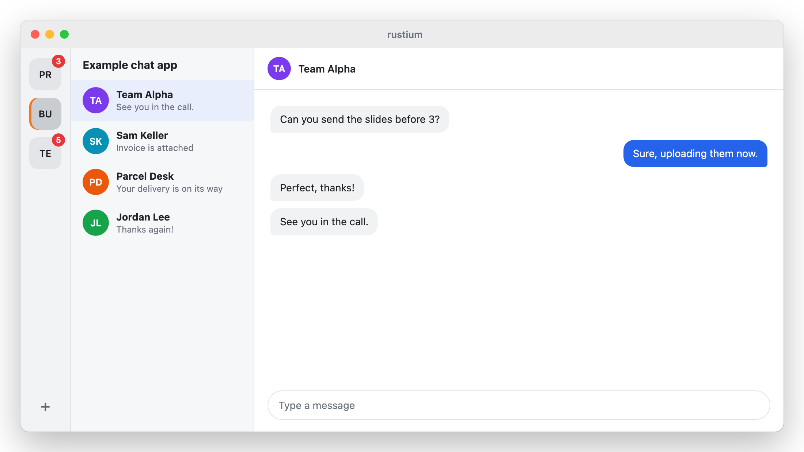
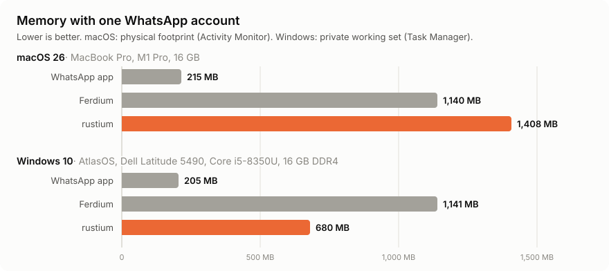
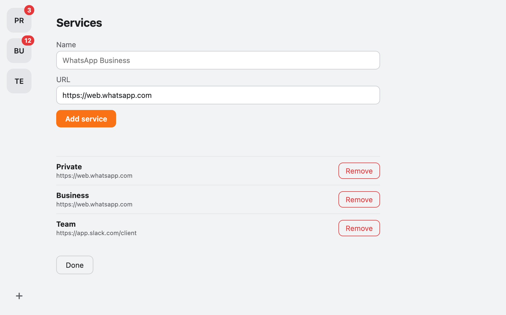
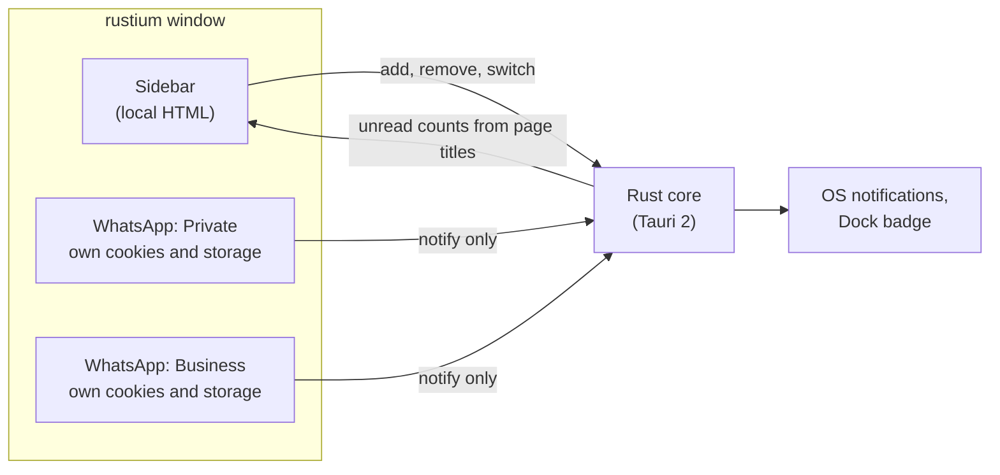

<div align="center">


# rustium

**Several WhatsApp Web accounts, or any other web app, side by side in one small Rust app.**

A proof-of-concept remake of [Ferdium](https://github.com/ferdium/ferdium-app), built with [Tauri 2](https://v2.tauri.app).

[](https://github.com/PrevosHD/rustium/releases)

[](LICENSE)

[Download](#download) · [Results](#results) · [Features](#features) · [Known limits](#known-limits) · [Build](#build-from-source)

</div>

> [!WARNING]
> **Proof of concept, not actively maintained.** rustium was built out of experimental interest and **vibe-coded with the help of Claude**, Anthropic's AI assistant. The code was largely written by AI and has not had a thorough human review. Use it at your own risk.
>
> Issues are welcome, and I may look into them, but only in my spare time. There is no guarantee of a reply or a fix.

<picture>
  <source media="(prefers-color-scheme: dark)" srcset="docs/illustration-dark.png">
  
</picture>

<sub>Illustration with a generic example chat app and made-up messages. In real use, WhatsApp Web or another web app fills the area next to the sidebar.</sub>

## The experiment

Ferdium bundles web messengers into one window, but as an Electron app it ships its own copy of Chromium. With several WhatsApp accounts that adds up to gigabytes of memory.

rustium asks a simple question: **does a Rust shell on the system's own web engine use less memory?**

- It rebuilds Ferdium's core idea from scratch. It contains no Ferdium code and is not affiliated with the Ferdium project.
- It was built with WhatsApp Web in mind, but a service is just a name and an `https://` URL, so any web app works.
- It uses WKWebView on macOS, WebView2 on Windows and WebKitGTK on Linux. The Windows installer is 2.4 MB, the macOS disk image under 4 MB.

## Results

<picture>
  <source media="(prefers-color-scheme: dark)" srcset="docs/memory-dark.svg">
  
</picture>

| | Windows 10 | macOS 26 |
|---|---|---|
| **rustium vs. Ferdium** | **about 40% less** (680 vs. 1,141 MB) | about 25% more (1,408 vs. 1,140 MB) |
| **Why** | Both run WhatsApp Web on Chromium, so rustium's lighter shell wins. | Apple's WebKit needs about 1.8 times as much memory as Chromium for WhatsApp Web, more than the shell saves. |

On macOS the official WhatsApp app is by far the lightest, at 215 MB. The Windows app still has to be measured while logged in.

<details>
<summary>How it was measured, with the full numbers</summary>

The same WhatsApp account was freshly logged in to all three apps, which were then left idle for a few minutes.

**macOS 26** on a MacBook Pro (M1 Pro, 16 GB), physical footprint as Activity Monitor counts it, summed over each app's processes:

| App | Total | WhatsApp page | The app itself |
|---|---|---|---|
| WhatsApp (official native app) | 215 MB | (no web page) | 190 MB |
| Ferdium | 1,140 MB | 671 MB (Chromium) | about 470 MB |
| rustium 0.1.0 | 1,408 MB | 1,217 MB (WebKit) | about 190 MB |

**Windows 10 (AtlasOS)** on a Dell Latitude 5490 (Intel Core i5-8350U, 16 GB DDR4), private working set as Task Manager counts it, measured with [`scripts/measure-memory.ps1`](scripts/measure-memory.ps1):

| App | Total | WhatsApp page | The app itself |
|---|---|---|---|
| WhatsApp (official app) | not measured yet: it was not logged in during this run | | |
| Ferdium | 1,141 MB | 579 MB (Electron's Chromium) | about 560 MB |
| rustium 0.1.0 | 680 MB | 433 MB (WebView2) | about 250 MB |

Windows lowers the working set of minimized windows, so compare the apps in the same window state.

</details>

## The service manager

<picture>
  <source media="(prefers-color-scheme: dark)" srcset="docs/screenshot-services-dark.png">
  
</picture>

Click **+** in the sidebar to add or remove services. Rendered from the app's own UI with sample services.

## Features

- **Isolated accounts.** Each service runs in its own webview with separate cookies and storage, so several accounts of the same messenger can be logged in at once.
- **Unread badges.** The sidebar shows unread counts, read from the page title (for example `(3) WhatsApp`).
- **Native notifications.** Web notifications become OS notifications, prefixed with the service name.
- **Always on.** Hidden services stay loaded and keep receiving messages. Closing the window keeps rustium running in the tray.
- **Downloads and drag and drop.** Files save to your Downloads folder, and you can drag files into a chat.
- **Locked down.** Web pages can only send notifications to the app, nothing else.

## Download

Get the latest build from the [releases page](https://github.com/PrevosHD/rustium/releases).

| System | File | Requires |
|---|---|---|
| Windows | `rustium_<version>_x64-setup.exe` or `.msi` | Windows 10 or later with WebView2 |
| macOS (Apple Silicon) | `rustium_<version>_aarch64.dmg` | macOS 14 or later |
| macOS (Intel) | `rustium_<version>_x64.dmg` | macOS 14 or later |
| Linux | `.AppImage`, `.deb` or `.rpm` | WebKitGTK 4.1 |

> [!NOTE]
> The builds are not code-signed. On Windows, SmartScreen warns: click **More info**, then **Run anyway**. On macOS, if the app cannot be opened, go to **System Settings > Privacy & Security** and click **Open Anyway**.

## Usage

1. On first start rustium opens one WhatsApp Web service. Scan the QR code with your phone.
2. Click **+** at the bottom of the sidebar to add a service: a name and an `https://` URL, which defaults to WhatsApp Web.
3. Remove a service in the same panel. This logs it out right away and deletes its stored data on the next start.

Services are saved in `services.json` in the app's config directory.

## Known limits

- **No microphone or camera.** Voice messages and taking photos do not work yet. WhatsApp Web also shows a banner recommending another browser, because rustium presents itself as Safari. Click OK to hide it.
- **Notification clicks** do not focus the window or switch to the service yet.
- **Linux layout is broken.** Child webviews ignore their position there, so the sidebar does not get its fixed width.
- **Windows:** each service gets its own WebView2 browser process, because Tauri does not expose WebView2 profiles yet. Several accounts therefore cost more than they would with shared profiles.
- **Background throttling** of hidden services can only be turned off on macOS. On Windows and Linux it is not yet verified that hidden services notify reliably.

## How it works



Each service is a child webview with its own data store. A small script inside each page replaces the browser's notification API and forwards notifications to the Rust core. Tauri's permission system lets remote pages call only that one command.

## Build from source

There is no npm or frontend build step. The UI in `ui/` is plain HTML that Tauri embeds at compile time.

1. Install Rust with [rustup](https://rustup.rs).
2. On Linux, install the WebKitGTK and tray dependencies. On Debian or Ubuntu:

   ```sh
   sudo apt update
   sudo apt install libwebkit2gtk-4.1-dev build-essential curl wget file \
     libxdo-dev libssl-dev libayatana-appindicator3-dev librsvg2-dev
   ```

   For other distributions, and for the macOS and Windows prerequisites, see the [Tauri prerequisites](https://v2.tauri.app/start/prerequisites/).
3. Run a development build:

   ```sh
   git clone https://github.com/PrevosHD/rustium.git
   cd rustium
   cargo run
   ```

4. Build installable bundles with the Tauri CLI. They are written to `target/release/bundle/`.

   ```sh
   cargo install tauri-cli --version "^2" --locked
   cargo tauri build
   ```

## Credits

- [Ferdium](https://github.com/ferdium/ferdium-app) for the idea of bundling web messengers into one app.
- [Tauri](https://tauri.app) for the Rust app framework and webview layer.
- Built with the help of [Claude](https://claude.ai), Anthropic's AI assistant.

## License

[MIT](LICENSE)
